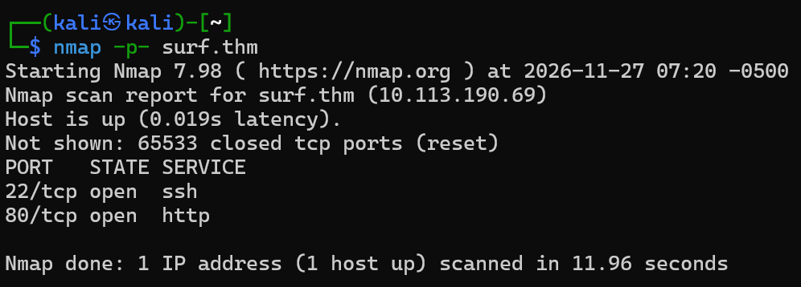
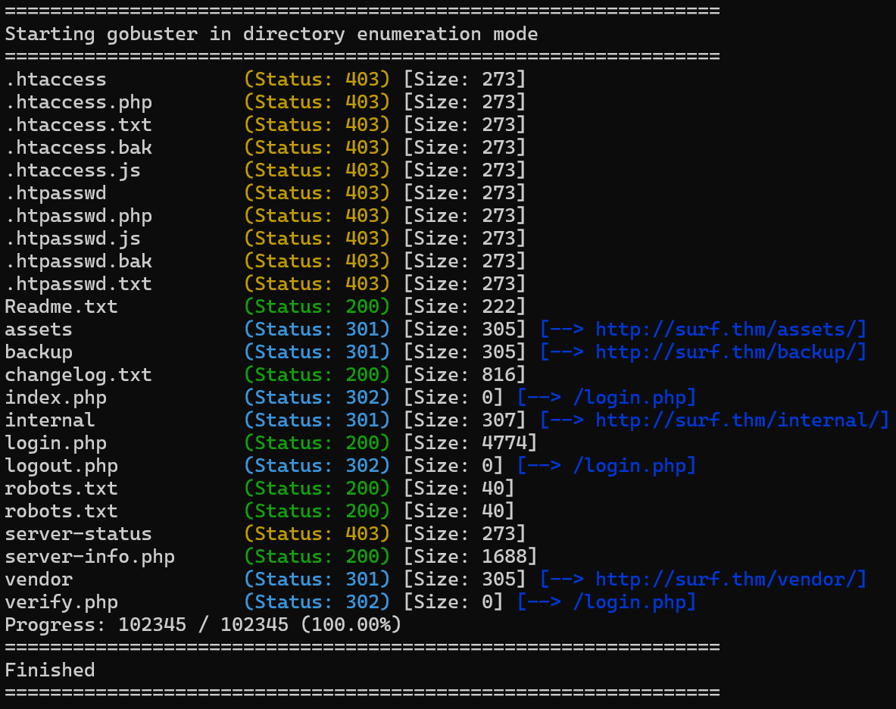
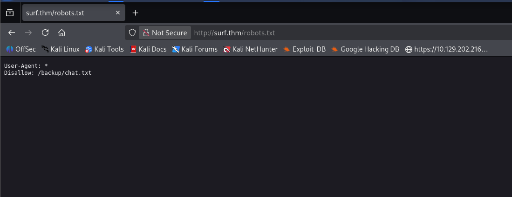
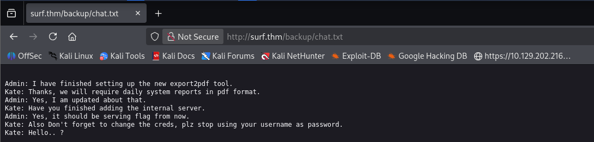
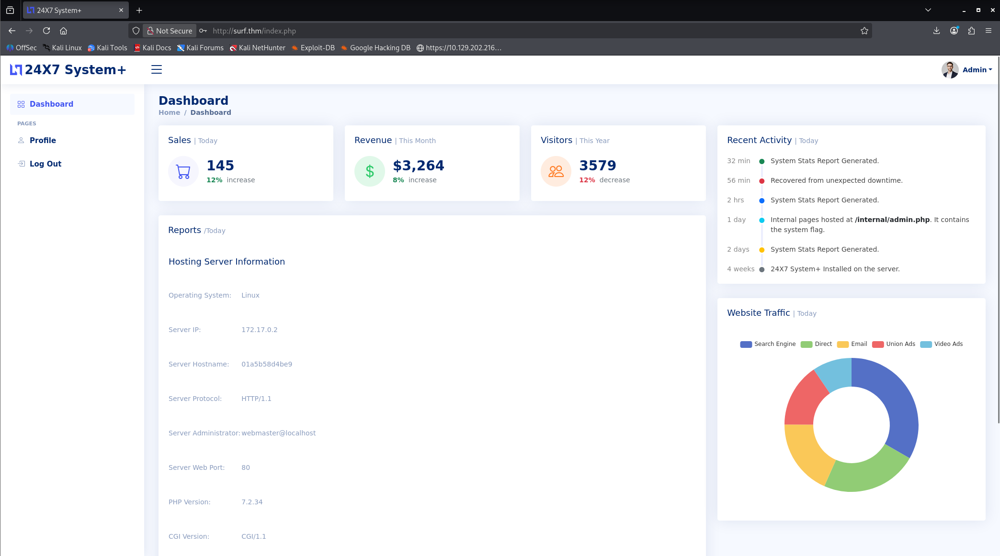
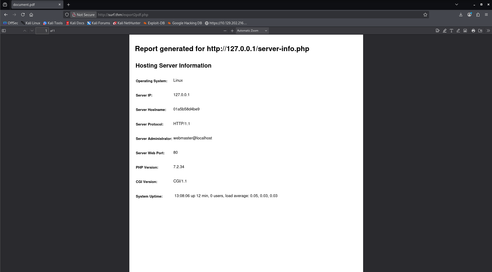
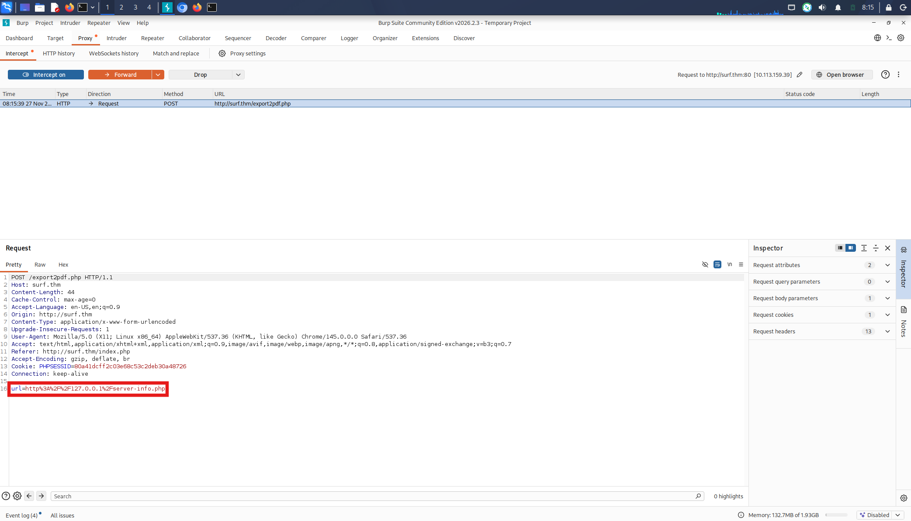
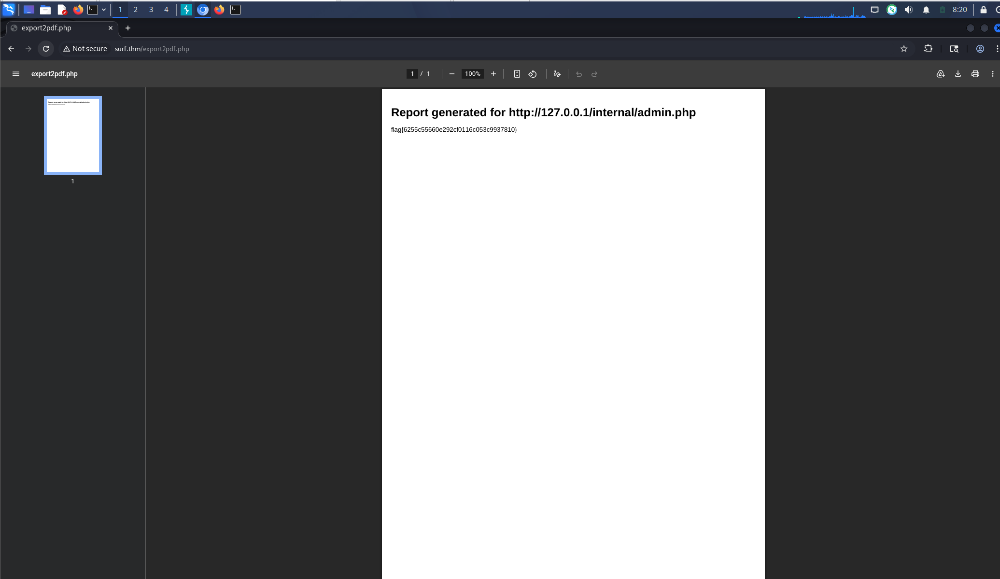

Tryhackme - surfer

- Write-Up Author: stijn.vgils

## Challenge Description:

> Beginner-friendly TryHackMe room focused on SSRF.

<small>note for other beginners: it can take a while to get to the right steps in these challenges. This writeup is meant as a guide for when youre stuck, don't get demotivated just because trial and error wasn't documented; there was definitely a lot of trial and error.</small>

---

# Writeup

## Enumeration

#### nmap (port enumeration)

`nmap -p- <ip>`

- 80: looks like a normal webpage, redirect is the login screen.

#### GoBuster (webpage enumeration)

`gobuster dir -u http://<ip>/ -w /usr/share/wordlists/dirb/big.txt -x php,txt,js`

##### /Readme.txt & /changelog.txt

These pages seemed like normal pages from the template that's used for this website, checked it for anything useful but couldn't find anything.

##### /backup, /internal, /assets & /vendor

These pages are all the same: "Forbidden". Lets move on for now.

##### /robots.txt

Robots.txt had some interesting information for me:

robots.txt is usually used to tell [crawlers](https://www.cloudflare.com/learning/bots/what-is-a-web-crawler/) which pages they are and aren't allowed to index. In this case, it told me about a webpage that we did not know yet. This page happens to have sensitive information, which the website administrator probably doesn't want me to know about:

This tells me two things:
1. The tool that I will probably exploit is export2pdf
2. there is a user called admin that uses their username as a password (🤦‍♂️)

Logging in on the login form with admin / admin works. We are now on the webpage. On the homepage, in the top right, I saw a "Recent activity" tab. This tab exposed the location of the flag: "/internal/admin.php". Of course, I clicked it. This gave the message "This page can only be accessed locally."

## SSRF (compromising the flag)
If I scroll down, I see a "Export to PDF" button. From the enumeration steps, I already made a guess that this is the tool that will be exploited. Pressing the button showed me a PDF with some site info:

What's interesting is the title of the document. It seems like the export2pdf tool called it's localhost IP (127.0.0.1), if we figure out how we can change the request, we might be able to reveal information that should only be accessible from the machine itself (this is called SSRF, or, Server Side Request Forgery, as we make the server execute a request that we aren't allowed to make as a regular visitor). Remember the error message from earlier? "This page can only be accessed locally."

### Changing the request
To see how the request was being made, I started Burp Suite. Burp Suite is a web application security testing and penetration testing platform made by Portswigger, it can act as an intercepting proxy between a browser and a target.
I started a Burp Suite project in memory, went to the proxy tab, opened a browser and went to the webpage. Once I was on the home screen, I set the proxy to Intercept mode ("Intercept on") and pressed the convert to PDF button.

As highlighted in the red box, button makes a POST request to `http%3A%2F%2F127.0.0.1%2Fserver-info.php`, the entire URL is URL-Encoded (%3A is a URL encoded colon (:), %2F is a URL encoded forward slash (/)) as it is being passed as an argument for the POST request. To point it to the location of the flag (/internal/admin.php), I changed the request in burp to `http%3A%2F%2F127.0.0.1%2Finternal%2Fadmin.php`, and pressed forward. 
This generated a PDF based on the HTML page that is found on /internal/admin:

On that page was indeed the flag: flag{6255c55660e292cf0116c053c9937810} 🥳
